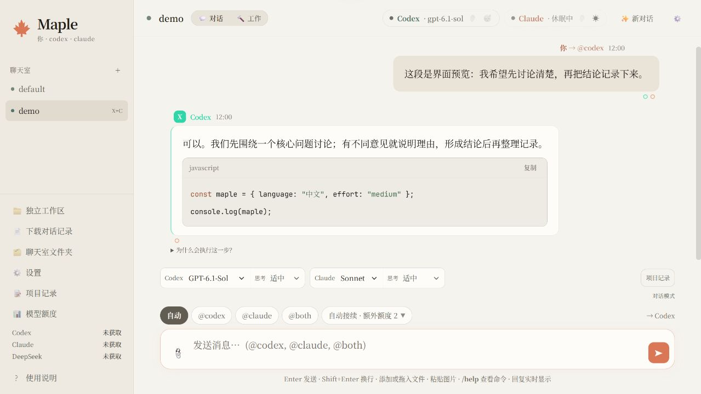

# 🍁 Maple

一个简洁的本地 AI 讨论室：你、Codex 和 Claude 在同一个聊天窗口里交流，DeepSeek 可以按需整理项目记录。

Maple 基于 [auspex0/Parley](https://github.com/auspex0/parley) 1.2.1 定制，保留上游 MIT 许可与作者信息。这里发布的是源码预览版，尚未提供独立安装包。



*截图中的对话是排版检查用的人工示例，没有调用模型生成。*

## 有哪些变化

- 暖白底、枫叶图标和思源宋体；聊天正文与输入框为 17px，代码使用 JetBrains Mono。
- 默认中文界面，常用设置简化，较少使用的选项收在“高级设置”。
- 在聊天区直接选择模型与思考强度，无需反复打开设置。
- 默认额外额度为 2；“额外额度”控制自动接续，“账号额度”显示服务商提供的账户使用情况。
- 可选 DeepSeek 记录员：保留原始 Markdown 对话，手动整理摘要，检查后再让双方从摘要继续。

## 怎么开始

1. 安装 [Node.js 22 或更新版本](https://nodejs.org/)。
2. 安装并登录你要使用的官方 CLI：Codex 或 Claude Code。可以先只用其中一个，将另一个设为休眠。
3. 下载本仓库 ZIP，解压到你喜欢的文件夹。
4. Windows 用户双击根目录的 **start-maple.cmd**。

也可以在源码目录运行：

```sh
node parley.mjs
```

正常启动后会打开 `http://127.0.0.1:4141`。窗口只是本机网页，不是 Claude 或 Codex 的官方客户端。普通聊天通过本机 CLI 工作；DeepSeek 记录员需要单独的官方 API Key。

如果使用终端，可以指定数据文件夹：

```sh
node parley.mjs --root "D:/Maple/rooms" --port 4141
```

终端和 Windows 快捷启动默认都使用 `~/.maple`，即当前用户目录下的 `.maple` 文件夹。需要换位置时给启动脚本传入 `-DataDir`，或在终端使用 `--root`。不同数据目录的聊天室相互独立。

Windows 快捷启动如果没有检测到 Node.js，会显示安装提示并保留错误窗口。停止后台服务可在“项目记录 / 聊天室文件夹”保存好工作后关闭对应 Node 进程；命令行前台启动时按 Ctrl+C。

## 日常使用

- 直接输入：发送给当前默认或上次选择的智能体。
- `@codex`、`@claude`：指定谁回复。
- `@both`：双方参与讨论；请先确保双方均已登录并唤醒。
- 模型旁的“思考”：选择轻量、适中、深入等强度；列表根据当前模型目录提供，账号实际可用性由服务商决定。
- 额外额度 2：首次指定回复不计入，后续自动启动计入；它不是 token、金额或完整讨论轮数的保证。
- 👂 旁听会产生额外调用；不需要时保持关闭。

模型或思考强度切换会从下一条消息生效，并重新建立所选智能体的原生会话。原始聊天和已采用记忆保留；有任务在运行或排队时不能切换。

## DeepSeek 项目记录

记录员是可选功能，不填写 Key 也能正常聊天。当前整理模型固定为 `deepseek-flash`，使用 DeepSeek 官方接口；请确认自己的账户实际支持该模型。

1. 打开“项目记录”，填写官方 API Key 和需要的本机文件夹。
2. 有对话后点“整理记录”；这会把需要整理的对话和相关已有记忆发给 DeepSeek，并产生 API 费用。
3. 检查摘要，必要时填写修订说明。
4. 点“用这份记录继续”，双方后续从共同记忆与最近对话接续。

原始对话保留；摘要可以修正，不能代替原始证据，也不会自动授权执行其中的建议。附件正文不会自动复制进记录或发送给记录员。

当前 API Key 保存使用 **Windows DPAPI**，只在当前 Windows 用户下解密。macOS/Linux 可运行基础聊天室，但本版尚未提供这些平台的记录员密钥存储，也未验证其日常使用兼容性。

## 账号额度

- Codex：读取 CLI 提供的账户额度元数据，和其他使用同账号的客户端共享。
- Claude：从普通回复中的限额事件读取；没有拿到数据时显示“未获取”，不猜测百分比。
- DeepSeek：只显示官方余额。

Codex 重置卡仅在接口实际返回可用卡时显示。点击消耗一张需要明确操作；刷新页面不会使用卡。Claude 提供官方用量页入口，不伪造一键重置。

## 权限与数据

新安装默认采用对话模式和保守权限。需要修改文件时再切换工作模式，并选择合适的项目文件夹。完全访问属于高级选项，不是推荐默认值。CLI、操作系统及明确的用户要求仍然决定实际权限范围。

个人偏好、聊天数据、密钥和日志不属于源码。本仓库没有作者本机的账号配置、自动审批配置或聊天记录。字体随源码离线提供，许可位于 `ui/fonts`；没有打包 SF Mono 或 Anthropic 字体。

## 验证与限制

```sh
node --test --test-timeout=30000 test/*.test.mjs test/unit.mjs
```

这些检查使用模拟 CLI/API，不调用付费模型。当前版本在 Windows 上验证了 58 项检查，以及启动、字体加载和聊天区参数切换。仓库 CI 会持续检查这组功能。

界面和记录模块仍是早期预览。上游调度器测试保留在 `test` 中，测试说明见 [验证说明](docs/VALIDATION.md)。不要将上游的历史验证记录当作本版本已验证的结果。

## 来源与许可

- 上游：[Parley](https://github.com/auspex0/parley)，MIT，Copyright (c) 2026 auspex0。
- UI 字体：[Adobe Source Han Serif](https://github.com/adobe-fonts/source-han-serif)，SIL OFL 1.1。
- 代码字体：[JetBrains Mono](https://github.com/JetBrains/JetBrainsMono)，SIL OFL 1.1。

原版说明保存在 [UPSTREAM-README.md](docs/UPSTREAM-README.md)。Maple 是独立的社区定制版，与 OpenAI、Anthropic 和 DeepSeek 没有官方隶属关系。
